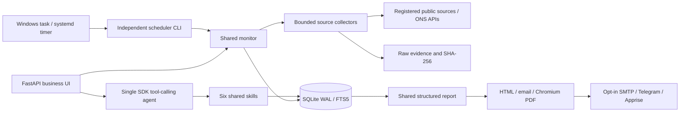

# London Office Intelligence

DeepInsight Mini is a Python market-monitoring PoC for London office asset managers. It combines a chat-first research interface, a source-backed dashboard, an independent monitor, saved briefings and opt-in delivery. It is isolated from `D:\deepinsight-lite`.

## Run locally

The development instance is at **http://127.0.0.1:8766/** (Ask AI). Open **http://127.0.0.1:8766/overview** for the dashboard.

```powershell
cd D:\deepinsight-mini
python -m venv .venv
.\.venv\Scripts\python.exe -m pip install -r requirements.lock
$env:PLAYWRIGHT_BROWSERS_PATH="$PWD\.browsers"
$env:PLAYWRIGHT_SKIP_BROWSER_GC='1'
.\.venv\Scripts\python.exe -m playwright install chromium
.\.venv\Scripts\python.exe -m deepinsight init
.\deployment\windows\Start-Local.ps1
```

On this workstation, the network tunnel uses benchmark DNS addresses. Start with `Start-Local.ps1 -TunnelDns`. This opt-in accepts only the two recognized benchmark DNS ranges for registered HTTPS hosts, keeps TLS verification enabled and still rejects loopback/private targets. Keep this mode off on ordinary networks and VPS deployments.

The app reads process environment variables, not `.env` automatically. See `.env.example`. Model configuration uses `MINI_API_KEY`, `MINI_BASE_URL`, `MINI_MODEL`, with existing `LLM_*` variables as fallbacks. The user now authorizes **ToAPIs and official DeepSeek**. Add personal keys in `/settings#api-connection`, or use the encrypted workspace presets. Personal keys are Windows DPAPI encrypted under ignored `data/private/providers/`, never returned or stored in SQLite/client storage. Provider URLs are allowlisted, TLS verified, redirects disabled. Personal profiles and uploads are owner isolated; the research workspace itself remains shared.

## Current verified status

As of the 19 October 2026 acceptance run:

- Actual collection succeeded for seven endpoints across Savills, City of London, Bank of England and ONS.
- Current database contains 101 source-reported observations and the dashboard summarizes 21 metric/geography/definition series. These are extraction evidence, **not automatically approved quantitative conclusions**.
- All eight assessment concerns have questions and source mapping. Seven contain numeric evidence; news/events are qualitative. Dedicated Canary Wharf and Midtown series, direct hybrid-working measures and wider broker coverage remain gaps.
- The replacement official DeepSeek key and ToAPIs GPT, Gemini and Claude each returned a real successful completion. Historical HTTP402 receipts remain historical; no blocked key is silently reused. See `docs/CONNECTED_CHAT_ACCEPTANCE.md`.
- The earlier six-question batch was HTTP402-blocked. A new real browser flow saved a personal key, refreshed models, selected GPT thinking, uploaded text and completed actual domain/SQL tool calls plus an exact file quote. These runs are recorded separately.
- A Windows scheduled task triggered a successful controlled morning monitor independently of the web UI. Default London schedules are 08:00 and 18:00.
- A real SMTP exchange reached a loopback capture recipient once; the repeat was deduplicated. External email/Telegram delivery remains disabled and unverified.
- HTML/email/PDF generation, PDF download/rendering, persistent conversations/settings and mobile containment were exercised.

See `docs/ACCEPTANCE.md` and `output/evidence/` for evidence and limitations. A five-slide business deck is in `output/slides/`.

## Product pages

| Page | Purpose |
|---|---|
| Ask AI (`/`, `/ask`) | Central chat, saved history, source-linked research and eight assessment prompts |
| Overview (`/overview`) | Inspect source-reported values, periods, submarkets, review states, source health and coverage |
| Market Monitor (`/monitor`) | Run checks, inspect source health, snapshots, signal history and scheduler heartbeat |
| Reports (`/reports`) | Reopen saved HTML briefings and download PDF/HTML |
| Settings (`/settings`) | API keys, models/thinking, focus, London schedules and opt-in delivery |

Dashboard source-reported cards intentionally show pending observations for inspection. Following the user's request for visible data charts, the interactive ECharts dashboard shows original CPI, employment, GDP and source-reported market snapshots with source/period/pending-review labels and inspectable data points. Each raw chart requires one current official source/definition/unit and exact agreement between the plotted value and the retained original JSON evidence. They are separate from approved quantitative reports and approved market trend charts. Without two compatible reviewed observations, the approved market trend area says history is insufficient. Coverage bars describe evidence availability, not market performance.

## Assessment coverage

| Business concern | Implemented evidence/metric | Source |
|---|---|---|
| Prime / Grade A rents | Separate City / West End figures and definitions | Savills Q2 2026 office report |
| Vacancy / availability | Vacancy percentages and available supply area | Savills supply/vacancy section |
| Leasing take-up / activity | Quarterly and H1 take-up, transaction count | Savills leasing summary |
| Supply pipeline | Completions, under-construction area, pre-let share; planning milestone | Savills; City of London announcement |
| Submarkets | City, West End, City Fringe evidence; explicit Canary Wharf / Midtown gaps | Savills; public planning notices |
| Macro | Official Bank Rate, CPI D7G7, employment LF24, real GDP IHYQ | Bank of England; ONS JSON endpoints |
| Occupier demand | Grade A share, BREEAM share, active demand; qualitative hybrid-working gap | Savills demand analysis |
| News / events | Dated planning/research candidates, discovery-vs-publication distinction | City of London newsroom RSS and announcements |

The source registry lives in `config/sources.yaml`; question/metric contracts live in `app/dashboard.py`. Source URLs, original release/observation periods, hashes and exact evidence excerpts remain available in the UI. ONS monthly employment series labels can represent rolling estimates; the source definition remains authoritative. Bank Rate dates are effective-change dates. Macro figures do not establish London rent changes.

## CLI

```powershell
.\.venv\Scripts\python.exe -m deepinsight --help
.\.venv\Scripts\python.exe -m deepinsight monitor --run once
.\.venv\Scripts\python.exe -m deepinsight monitor --run morning
.\.venv\Scripts\python.exe -m deepinsight report --pdf
.\.venv\Scripts\python.exe -m deepinsight ask --question "What do we know about City vacancy?"
.\.venv\Scripts\python.exe -m deepinsight scheduler
.\.venv\Scripts\python.exe -m deepinsight model-check
```

`model-check` deliberately retries the provider and clears a cached block before checking. Normal chat does not repeat a known HTTP402 call. Failed AI analysis preserves evidence and report records.

## Validation

```powershell
.\.venv\Scripts\python.exe -m pytest -q
.\.venv\Scripts\python.exe -m ruff check app tests tools
.\.venv\Scripts\python.exe -m compileall -q app deepinsight tools
.\.venv\Scripts\python.exe -m pip check
.\.venv\Scripts\python.exe -m tools.browser_acceptance
```

Tests use temporary databases and clearly marked synthetic fixtures. They do not establish market changes or successful live AI. Browser acceptance requires the running app and retained real sources. The current FastAPI/Starlette test client emits one upstream HTTPX deprecation warning; checks are not disabled.

## Architecture



External source text is untrusted data. Agent tools cannot approve facts or fetch arbitrary URLs. Numeric publication requires human review, exact source evidence and compatible metric/geography/definition/unit/publisher/period frequency. Same-period revisions are retained but not trends. Source restorations A→B→A retain history and update the current-state pointer. Invalidated source/observation dependencies withdraw active signals and mark historical downloads.

## Deployment and operations

See `RUNBOOK.md` for Windows schedules, Linux systemd setup, secrets, backups, recovery, notification gates and troubleshooting. Windows shutdown stops local scheduled monitoring; continuous operation needs an online host. No VPS deployment or long-running service reliability claim is made.

## Connected chat and BI delivery

Read [current acceptance](docs/CONNECTED_CHAT_ACCEPTANCE.md). Chat input is 19px desktop / 16px mobile, with a real file plus button and model/thinking controls. Upload PDF/DOCX/UTF-8 text/CSV/JSON or PNG/JPEG, max8MiB/file and five files. Uploads never become approved observations. Text extraction is bounded at24,000 characters; scanned PDFs need prior OCR. Images require a vision-capable model. A connection check proves transport only; agent success separately requires actual tools and evidence validation.

Dashboard filters reach `/api/dashboard/overview` and the read-only parameterized SQLite semantic layer. ECharts points and the accessible data tables open original evidence. Reviewed mode is default; View collected source figures explicitly enters pending inspection mode. Missing metrics remain Not Verified. Single-period source snapshots do not establish trends. Eight domain skills use one registry and optional stdio MCP adapter. PDF development is paused as requested.
